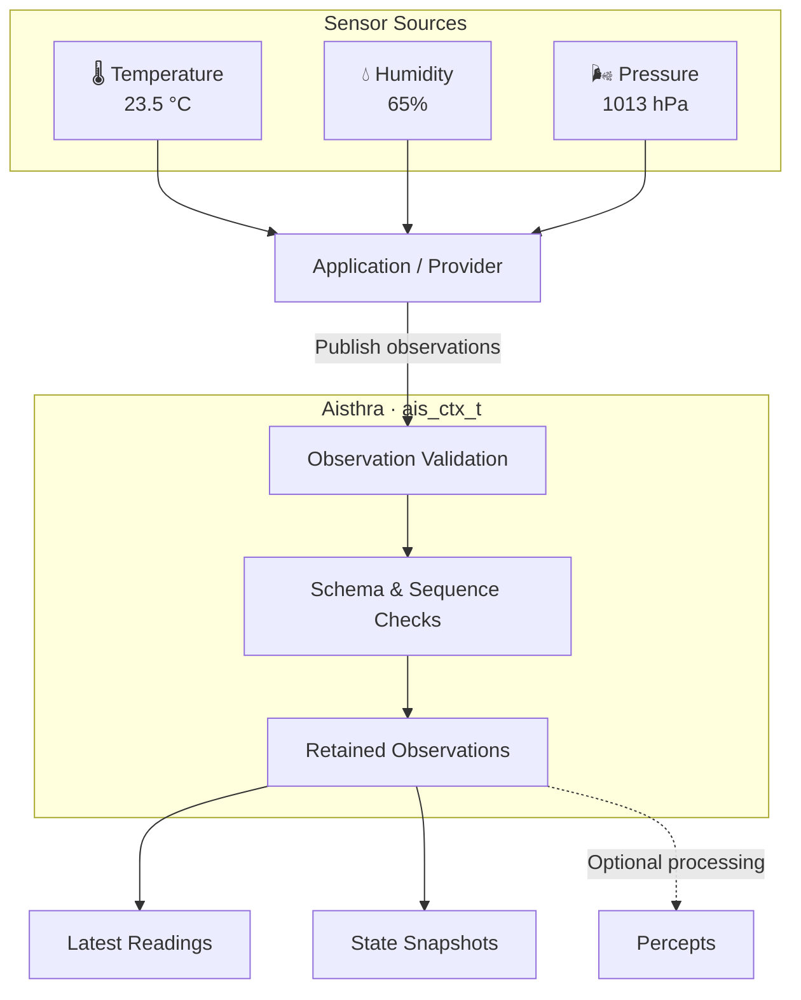

# Aisthra

**Version:** `0.1.0` · **Language:** C17 · **License:** MIT

Aisthra is a portable C17 library for validated sensor observations, typed payloads,
perception results, and bounded state snapshots. Its public API is shared across
supported desktop and embedded environments.

## Features

- Single C17 engine with C++17-compatible public headers.
- Typed observations, schemas, providers, and sensors.
- Observation validation, sequence handling, and optional percept generation.
- Bounded observation history and state snapshots.
- Static and shared CMake libraries (`aisthra::static`, `aisthra::shared`).

## Architecture

Aisthra receives observations from multiple sensor sources and makes accepted
information available through its public API.



See [Architecture](docs/architecture.md) for components, data flow, memory ownership,
and concurrency rules.

## Platforms

| Platform | Architecture | Validation |
|---|---|---|
| Linux | x86-64 | Native runtime validated |
| ESP32 Classic | Xtensa LX6 | Physical ESP-IDF runtime validated |

The ESP32 Classic physical validation used ESP-IDF 6.1.0 on an ESP32 DevKit V1.
It validates the Aisthra engine and ESP-IDF integration with logical sensors and
deterministic observations generated in memory. No physical sensor or board
peripheral was used. ADC, GPIO, I²C, SPI, real sensor acquisition, and Arduino
physical runtime remain outside this result. QEMU coverage and Arduino build
compatibility remain documented in [Validation](docs/validation.md).
See the complete [ESP32 physical validation report](docs/validation-esp32-physical.md)
for evidence, measurements, and limitations.

## Build

Requires CMake 3.20+, a C17 compiler, and the platform's supported threading interface.

```bash
cmake -S . -B build -DCMAKE_BUILD_TYPE=Release -DAISTHRA_BUILD_TESTS=OFF
cmake --build build
```

See [Development and Installation](docs/development.md) for installation,
test commands, build options, and benchmarks.

## Quick start

The example below publishes a simulated temperature reading. Full source:
[`examples/basic_temperature.c`](examples/basic_temperature.c).

```c
#include <aisthra/aisthra.h>
#include <stdio.h>

int main(void)
{
    ais_ctx_t *ctx = NULL;
    ais_sensor_id_t sensor = 0u;
    ais_ingest_result_t result;
    ais_error_info_t error;
    double value = 0.0;
    ais_status_t status;

    // Initialize the result and error structures.
    ais_error_info_init(&error);
    ais_ingest_result_init(&result);

    // Create an Aisthra context with default settings.
    status = ais_ctx_create_default(&ctx, &error);

    // Register a temperature sensor using the Celsius unit.
    if (status == AIS_OK)
        status = ais_sensor_register_simple(ctx, AIS_SV("temperature-0"),
            AIS_SV("environment.temperature.v1"), AIS_SV("celsius"),
            &sensor, &error);

    // Publish a temperature reading of 23.5 degrees.
    if (status == AIS_OK)
        status = ais_publish_f64(ctx, sensor, 23.5, &result, &error);

    // Retrieve the latest temperature reading.
    if (status == AIS_OK)
        status = ais_latest_f64(ctx, sensor, &value, &error);

    // Report errors and release resources if an operation fails.
    if (status != AIS_OK) {
        fprintf(stderr, "operation failed: %s\n", ais_status_name(status));
        (void)ais_ctx_close(&ctx, &error);
        return 1;
    }

    // Display the temperature and its observation sequence.
    printf("temperature=%.1f C (sequence=%llu)\n", value,
           (unsigned long long)result.sequence);

    // Release the context and its managed resources.
    (void)ais_ctx_close(&ctx, &error);
    return ctx == NULL ? 0 : 1;
}
```

Build and run:

```bash
cmake -S . -B build/example -DAISTHRA_BUILD_TESTS=OFF
cmake --build build/example --target aisthra_basic_temperature
build/example/aisthra_basic_temperature
```

## Documentation

- [Architecture](docs/architecture.md) — concepts and data flow.
- [API Reference](docs/api.md) — public headers and complete function index.
- [Contracts and Thread Safety](docs/contracts.md) — ownership, errors, and concurrency.
- [Embedded Systems](docs/embedded.md) — platform integration and constraints.
- [Validation and Testing](docs/validation.md) — complete test matrix and results.
- [ESP32 Physical Validation](docs/validation-esp32-physical.md) — ESP-IDF hardware run and measurements.
- [Development and Installation](docs/development.md) — builds, testing, and benchmarks.
- [References](docs/references.md) — official platform and toolchain references.

## License

MIT License. See [LICENSE](LICENSE).
